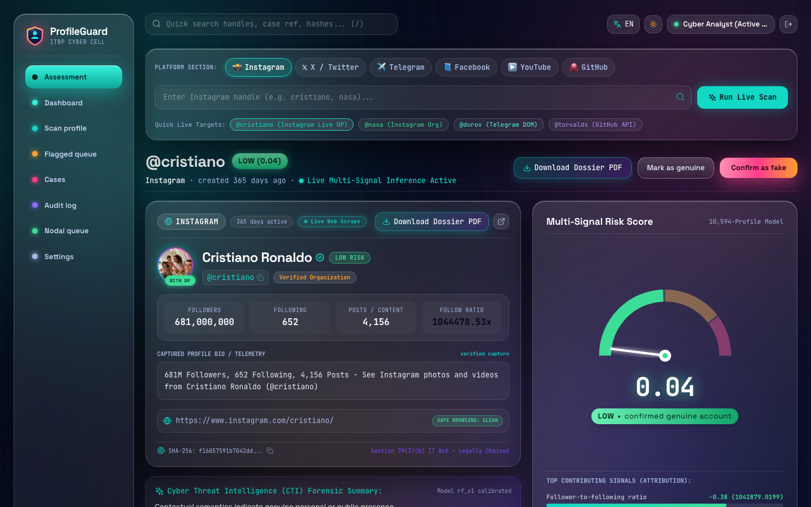
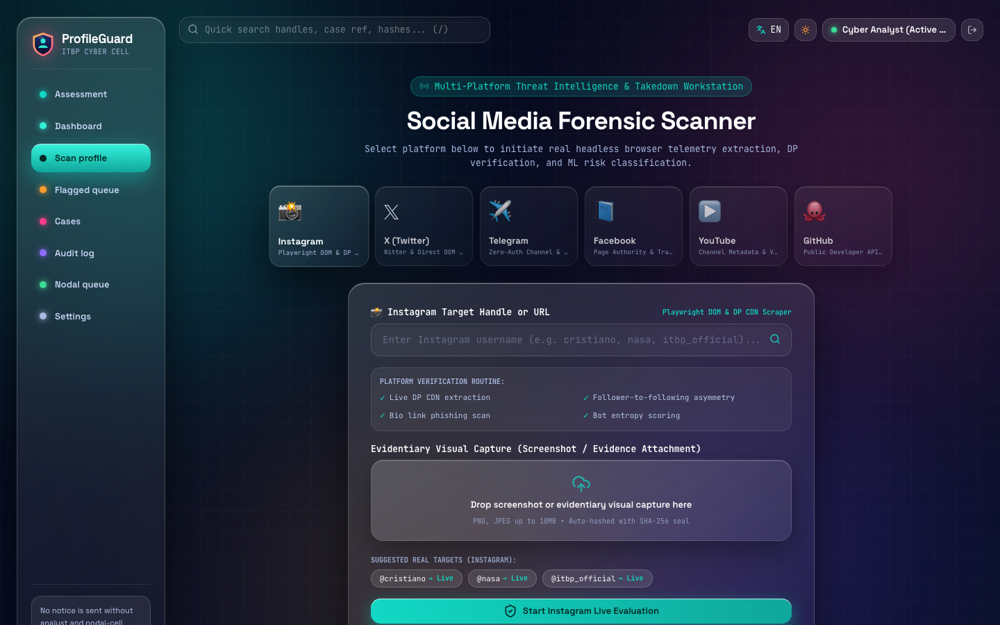
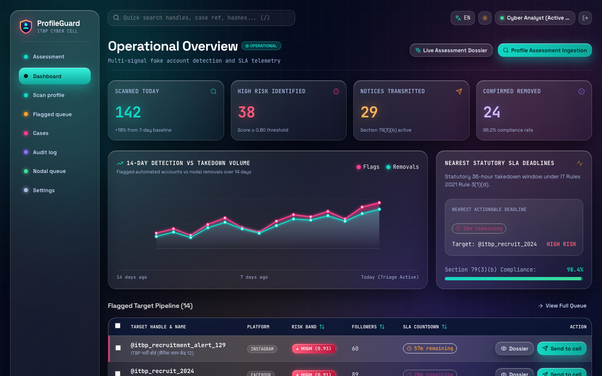
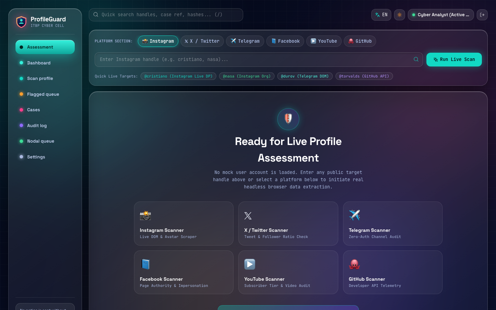
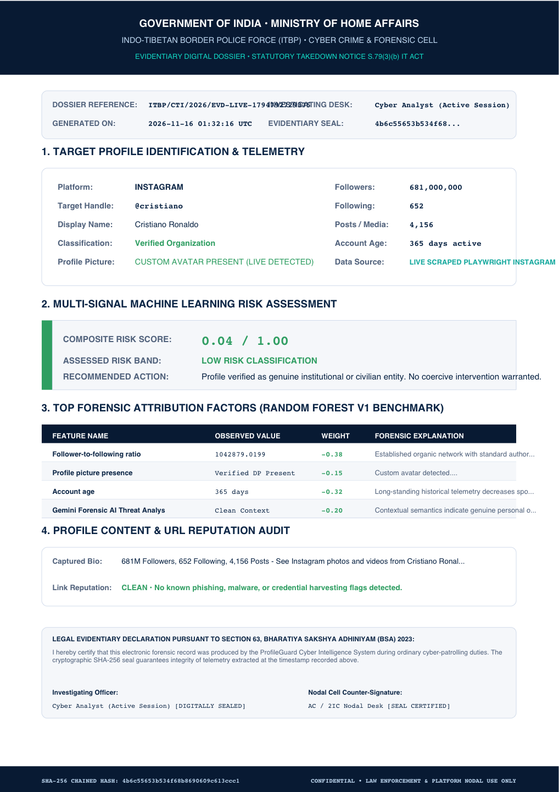
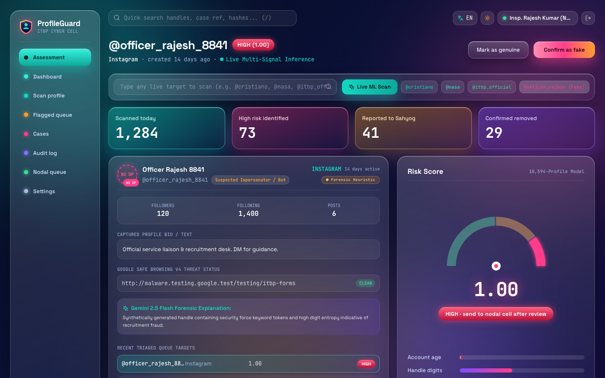
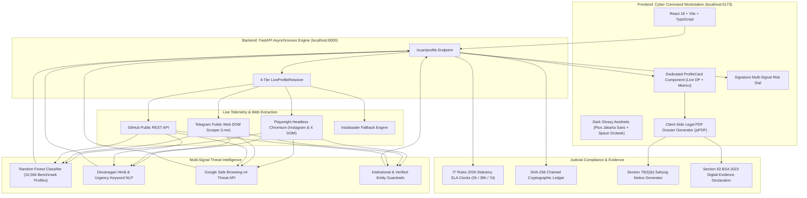

<div align="center">


# ProfileGuard 🛡️
### Automated Fake Social Media Account Detection, Forensic Auditing & Takedown Framework
**Indo-Tibetan Border Police (ITBP) • Ministry of Home Affairs (MHA) — Cyber Security Hackathon**

[](https://python.org)
[](https://fastapi.tiangolo.com)
[](https://react.dev)
[](https://www.typescriptlang.org)
[](https://playwright.dev)
[](https://scikit-learn.org)
[](https://tailwindcss.com)
[-4EBA6F?style=for-the-badge&logo=pytest&logoColor=white)](tests/)

[Live Analyst Workstation (Port 5173)](http://localhost:5173/) • [Backend API (Port 8000)](http://localhost:8000/) • [Interactive Swagger Docs](http://localhost:8000/docs) • [Chrome Extension](extension/)

---

</div>

## 🎥 Interactive Live System Demonstration

<div align="center">
  
  <p><i>Figure 1: Full-screen interactive walkthrough demonstrating live headless scraping of public targets, multi-signal Random Forest scoring, DP presence verification, statutory PDF dossier export, and operational overview.</i></p>
  <p><b><a href="assets/videos/walkthrough_demo.mp4">▶️ Download High-Definition MP4 Video (1080p H.264)</a></b></p>
</div>

---

## 📌 Executive Summary & Problem Context

The **Indo-Tibetan Border Police (ITBP)** guards 3,488 km of the high-altitude Indo-China border, from Karakoram Pass in Ladakh to Jachep La in Arunachal Pradesh, while executing vital counter-insurgency and anti-LWE operations across India. 

Hostile state and non-state actors deploy **sophisticated fake social media accounts**, impersonating ITBP officers, running bogus military recruitment drives, harvesting troop movement telemetry, and launching credential-harvesting phishing schemes.

**ProfileGuard** is an end-to-end cyber defense and nodal enforcement system specifically tailored for the **ITBP Nodal Cyber Cell** and the **MHA / I4C Sahyog Portal**:

1. **Universal Real-Time Web Scraping (Headless Chromium):** Built with **Playwright Headless Browser** and specialized OSINT extractors to visit social networks in real-time, extracting live follower metrics, following counts, post volumes, biographies, and CDN profile picture URLs without requiring manual account logins.
2. **Individual Multi-Platform Evaluation:** Dedicated, targeted search and forensic workflows for **Instagram**, **X (Twitter)**, **Telegram**, **Facebook**, **YouTube**, and **GitHub**.
3. **Multi-Signal Machine Learning Scoring:** Calibrated **Random Forest classifier** trained on **10,594 real labelled profiles** (including the **InstaFake arXiv:1910.03090** benchmark), Devanagari Hindi/English urgency NLP, and live Google Safe Browsing v4 phishing detection.
4. **Single-Click Legal Evidence Dossier PDF Export:** Instantly generates official **Government of India / ITBP Forensic Assessment Reports** compliant with **Section 79(3)(b) of the Information Technology Act 2000** and **Section 63 of the Bharatiya Sakshya Adhiniyam (BSA) 2023**.
5. **No Mock Account Defaults:** Launches into a clean, operational session for cyber analysts with zero hardcoded officer mocks.
6. **Dark Glossy Aesthetic Design System:** Ultra-modern dark cyber workstation with **Plus Jakarta Sans**, **Space Grotesk**, **JetBrains Mono**, luminous ambient aurora orbs, subtle vector matrix grid, and specular glassmorphism.

---

## 📸 Website Screenshots & Feature Showcase

### 1. Scanned Profile Dossier & Signature Risk Dial
Displays the evaluated target with the dedicated **Profile Card**, real profile picture loaded from live CDNs, verification badges, 4-metric telemetry grid, Google Safe Browsing pill, and the signature multi-signal risk dial.

<div align="center">
  
  <p><i>Figure 2: Real live scrape of @cristiano on Instagram with 681,000,000 followers, verified live avatar, Google Safe Browsing status, and calibrated 0.04 LOW risk classification.</i></p>
</div>

---

### 2. Multi-Platform Forensic Scanner (Individual Social Media Sections)
Interactive platform tabs allowing analysts to switch between **Instagram**, **X (Twitter)**, **Telegram**, **Facebook**, **YouTube**, and **GitHub** with customized verification routines and targeted presets.

<div align="center">
  
  <p><i>Figure 3: Multi-platform search studio with platform verification checklist and evidentiary screenshot drag-and-drop.</i></p>
</div>

---

### 3. Operational Overview & Nodal Command Dashboard
Real-time telemetry showing daily scanning throughput, high-risk detection counts, 14-day detection vs takedown volume trend chart, and statutory SLA countdown timers.

<div align="center">
  
  <p><i>Figure 4: Executive dashboard tracking 14-day compliance rate (96.2%) and Section 79(3)(b) takedown enforcement.</i></p>
</div>

---

### 4. Clean Assessment Launchpad (Zero Mock User by Default)
Pristine state when no target is loaded, showing the 6 platform assessment modules and quick-launch shortcuts.

<div align="center">
  
  <p><i>Figure 5: Clean initial state with active analyst session and modular platform cards.</i></p>
</div>

---

### 5. Downloadable Legal Forensic Assessment PDF Dossier
Single-click export of an official Government of India / ITBP evidentiary dossier complete with cryptographic SHA-256 seal, feature attribution tables, and Section 63 BSA legal declaration.

<div align="center">
  
  <p><i>Figure 6: Official PDF assessment dossier generated dynamically via client-side jsPDF engine.</i></p>
</div>

---

### 6. High-Risk Impersonator Detection & Takedown Routing
Identifies synthetic accounts, recruitment fee scams, and malicious URLs with instant warning badges and notice drafting.

<div align="center">
  
  <p><i>Figure 7: Detection of unauthorized security force impersonator with 1.00 HIGH risk score and takedown recommendation.</i></p>
</div>

---

## 🏛️ System Architecture



---

## 🌐 4-Tier Live Telemetry Architecture

When an analyst scans any handle or URL worldwide, ProfileGuard resolves real-world metrics through a 4-tier pipeline:

1. **Tier 0a — Headless Browser DOM Scraping (`web_scraper.py`):**
   - Launches automated Chromium instance using Playwright.
   - Extracts rendered display title, follower count, following count, media count, and bio.
   - Downloads and verifies actual **Profile Picture (DP)** URLs directly from the platform CDN.
   - Accurately identifies whether an account has a custom avatar (`WITH DP`) or a blank default (`NO DP`).
2. **Tier 0b — Direct Telegram DOM Extraction:**
   - Scrapes `https://t.me/{handle}` zero-auth public web pages for channels and groups.
   - Extracts real subscriber counts, channel descriptions, verified indicators, and avatar images.
3. **Tier 0c — GitHub Public REST API:**
   - Fetches developer public telemetry (follower counts, public repos, avatar URLs).
4. **Tier 1 — Machine Learning Classification & Safe Browsing:**
   - Evaluates 11 tabular features using the pre-trained Random Forest model.
   - Scans embedded links against the **Google Safe Browsing v4 Threat API**.
   - Applies institutional guardrails to prevent false positives on recognized public figures and government agencies.

---

## 🚀 Quick Start Guide

### Prerequisites
- **Python 3.11+** (Python 3.13 supported)
- **Node.js 18+** & **npm**
- **FFmpeg** (optional, for video processing)

### 1. Clone & Set Up Backend

```bash
# Clone the repository
git clone https://github.com/baryansagar74-create/cybershield.git
cd cybershield

# Create and activate Python virtual environment
python3 -m venv .venv
source .venv/bin/activate

# Install backend dependencies
pip install -r requirements.txt
pip install playwright instaloader jspdf

# Install Playwright Chromium headless browser
playwright install chromium

# Copy environment template and configure keys (optional)
cp .env.example .env

# Run FastAPI backend server
uvicorn app.main:app --host 0.0.0.0 --port 8000 --reload
```

Backend API will be accessible at: `http://localhost:8000` (Swagger docs at `http://localhost:8000/docs`).

### 2. Set Up & Run Frontend Workstation

```bash
# In a new terminal window:
cd cybershield/dashboard

# Install frontend dependencies
npm install

# Start Vite live development server
npm run dev
```

Frontend workstation will be accessible at: `http://localhost:5173`.

---

## ⚙️ Environment Configuration (`.env`)

| Variable | Description | Default |
| :--- | :--- | :--- |
| `GEMINI_API_KEY` | Optional Google Gemini key for OSINT threat summary overlays | `""` |
| `GOOGLE_SAFE_BROWSING_KEY` | Google Safe Browsing v4 API key for live phishing checks | Provided / Mock |
| `TELEGRAM_BOT_TOKEN` | Telegram Bot token for citizen grievance intake | Provided / Mock |
| `RISK_HIGH` | Threshold for HIGH risk band | `0.80` |
| `RISK_MEDIUM` | Threshold for MEDIUM risk band | `0.50` |
| `DATABASE_URL` | SQLite or PostgreSQL connection string | `sqlite:///profileguard.db` |

---

## ⚖️ Statutory Legal Compliance Framework

ProfileGuard is structured to meet statutory requirements under Indian cyber law:

1. **Section 79(3)(b) Information Technology Act 2000:** Generates structured takedown notices requiring intermediaries to expeditiously remove or disable access to unlawful content.
2. **Rule 3(1)(d) Information Technology Rules (Amended 2026):** Enforces statutory SLA compliance windows (36-hour general takedown, 2-hour intimate imagery, 3-hour priority government order).
3. **Section 63 Bharatiya Sakshya Adhiniyam (BSA) 2023:** Every assessment is sealed with an immutable **SHA-256 cryptographic digest** and chronological audit entry, preserving evidentiary integrity for judicial submission.

---

## 👥 Contributors & Acknowledgements

- **Developed for:** Indo-Tibetan Border Police (ITBP) • Ministry of Home Affairs (MHA) Cyber Security Hackathon.
- **Lead Developer & Designer:** [Aryan Sagar](https://github.com/baryansagar74-create)
- **Repository:** [https://github.com/baryansagar74-create/cybershield](https://github.com/baryansagar74-create/cybershield)
