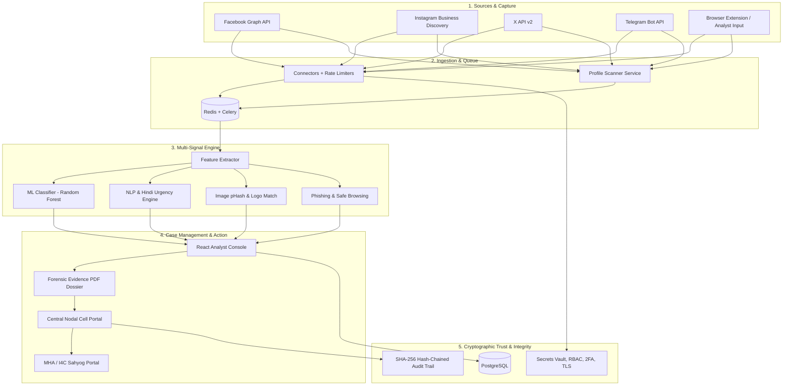

# ProfileGuard 🛡️

**Fake Social Media Account Detection, Reporting & Takedown Framework**  
*Developed for Indo-Tibetan Border Police (ITBP), Ministry of Home Affairs (MHA) — 2024 Problem Statement.*

---

## 📌 Executive Summary

The Indo-Tibetan Border Police (ITBP) guards the 3,488 km India-China border and carries out critical internal-security and anti-LWE operations. Sophisticated impersonation profiles, honey-traps, recruitment scams, and disinformation campaigns target personnel and operational security across platforms like X, Instagram, Facebook, and Telegram.

**ProfileGuard** delivers an end-to-end framework combining:
1. **Multi-Signal Detection Engine:** Tabular Random Forest ML classifier, Devanagari/Hinglish NLP scam text parsing, perceptual hashing (pHash) for stolen emblems/photos, and phishing domain reputation checks.
2. **Central Nodal Agency Takedown Workflow:** Structured Section 79(3)(b) notice package generation for filing through MHA/I4C **Sahyog portal** and platform Law Enforcement portals.
3. **Statutory SLA Monitoring:** Real-time countdown tracking under IT Rules 2021 (amended 2026: 3-hour government notices, 36-hour complaints).
4. **Cryptographic Forensic Integrity:** Tamper-evident SHA-256 hash-chained audit ledger ensuring evidence admissibility under Section 65B of the Indian Evidence Act / BSA.

---

## 🏛️ System Architecture



---

## ⚖️ Legal Framework & Timelines (IT Rules 2026)

*Note: All legal citations and timelines must be confirmed with ITBP legal cell (`CONFIRM WITH LEGAL`).*

| Statutory Trigger | Previous Timeline | Amended Rule (In force Feb 2026) |
|---|---|---|
| **Removal after reasoned Government Notice / Court Order (Rule 3(1)(d))** | 36 hours | **3 hours** |
| **Complaint on unlawful / impersonation content (urgent)** | 72 hours | **36 hours** |
| **General grievance disposal** | 15 days | **7 days** |
| **Intimate-imagery complaints (Rule 3(2)(b))** | 24 hours | **2 hours** |

### Applicable Penal Provisions
- **Section 66C, IT Act 2000:** Identity theft (fraudulent use of unique identification feature).
- **Section 66D, IT Act 2000:** Cheating by personation by using computer resource.
- **Section 67C, IT Act 2000:** Mandatory 180-day intermediate data preservation.
- **Bharatiya Nyaya Sanhita (BNS):** Cheating and impersonation of a public servant.

---

## 🚀 Quick Start Guide

### Prerequisites
- Docker & Docker Compose
- Python 3.11+ (for local development)
- Node.js 18+ (for dashboard development)

### 1. Clone & Configure
```bash
git clone https://github.com/itbp-cybershield/profileguard.git
cd cybershield

# Copy template and configure environment variables
cp .env.example .env
```

### 2. Run Complete Stack with Docker Compose
```bash
docker-compose up --build -d
```
Services initialized:
- **FastAPI Backend:** http://localhost:8000 (Docs at `/docs`)
- **React Analyst Console:** http://localhost:3000
- **PostgreSQL Database:** `localhost:5432`
- **Redis Queue:** `localhost:6379`
- **MailHog:** http://localhost:8025

### 3. Initialize Admin & Seed Demo Data
```bash
# Provision first analyst account
python3 scripts/create_admin.py

# (Optional) Seed realistic synthetic profiles & active cases
python3 scripts/seed_synthetic.py

# Verify cryptographic audit chain integrity
python3 scripts/verify_audit_chain.py
```

---

## 🧪 Running the Test Suite

```bash
# Run all unit and integration tests
pytest -v
```

---

## 📁 Repository Structure

```
cybershield/
|-- app/
|   |-- api/                # FastAPI endpoint routers (auth, scan, cases, reports, audit)
|   |-- connectors/         # Official API connectors (X, Meta/IG, Telegram, SafeBrowsing)
|   |-- features/           # Feature extraction (tabular 11 features, text NLP, image pHash, URLs)
|   |-- models/             # ML training, schema definitions, model registry
|   |-- cases/              # Takedown workflow state machine, SLA timers, Sahyog notice templates
|   |-- audit/              # SHA-256 hash-chained audit log & ledger verification
|   |-- security/           # JWT, TOTP 2FA, RBAC, secrets management
|   |-- config.py           # Pydantic Settings
|   |-- database.py         # SQLAlchemy engine & session factory
|   `-- main.py             # App entrypoint
|-- dashboard/              # React 18 Analyst Dashboard with Tailwind CSS
|-- extension/              # Chrome/Edge Manifest V3 Forensic Evidence Extension
|-- data/synthetic/         # Synthetic profile generation scripts & benchmark CSVs
|-- scripts/                # Admin CLI, seed tools, audit verification scripts
|-- tests/                  # Pytest unit and integration test suite
|-- docker-compose.yml      # Multi-container orchestration
|-- Dockerfile              # Production Python container
`-- requirements.txt        # Backend dependencies
```

---

## 🛡️ Responsible Disclosure & Governance

ProfileGuard strictly follows:
- **No Large-Scale Scraping:** Operates via official platform APIs or analyst-consented evidentiary submissions.
- **No Automated Takedowns:** Every requisition requires verified analyst confirmation and designated Nodal Officer sign-off.
- **Data Minimization:** Handled in accordance with India's **Digital Personal Data Protection (DPDP) Act, 2023**.
