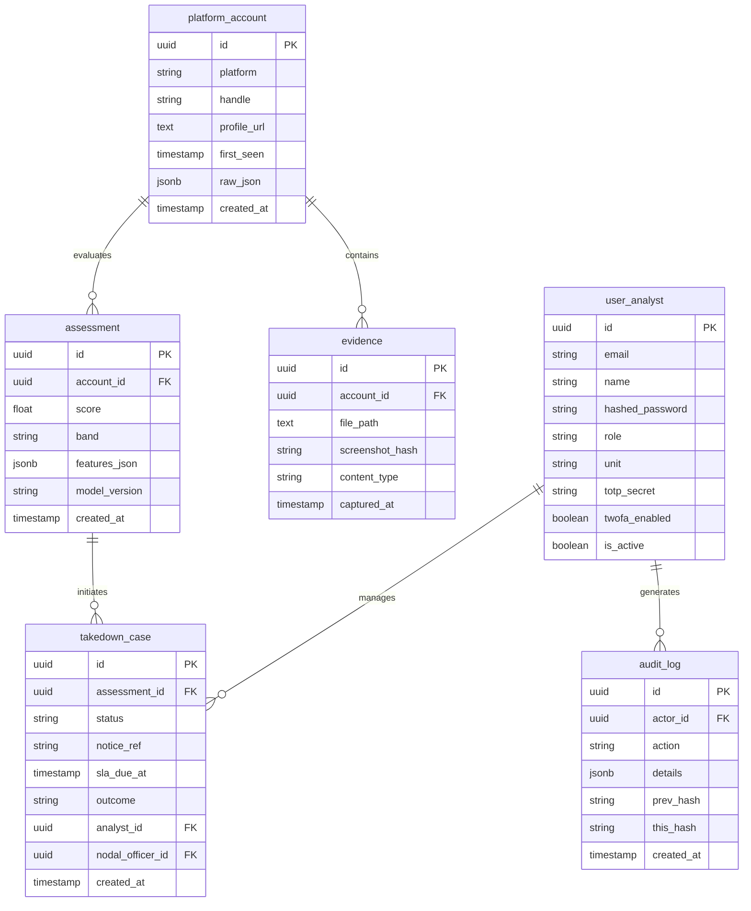

# ProfileGuard Technical Architecture

This document provides in-depth technical documentation of the ProfileGuard system components, database entity relationships, and forensic cryptographic chain verification.

## 1. Five-Layer System Architecture

ProfileGuard is structured across five decoupled layers:

### Layer 1: Data Sources & Evidentiary Ingestion
- **Official Platform APIs:**
  - **Meta Graph API (Instagram Business Discovery):** Inspects public Business/Creator accounts and verified pages.
  - **X API v2:** Paid user lookup and recent search with monthly credit budget controls.
  - **Telegram Bot API:** Channel and group membership metadata.
- **Analyst-Consented Extension:**
  - Manifest V3 Chrome/Edge extension capturing visible page metadata and generating cryptographic screenshot hashes with officer consent.

### Layer 2: Analysis & Feature Engineering
- **Tabular Features:**
  - 11-feature normalized vector (`followers`, `following`, `follow_ratio`, `posts`, `account_age_days`, `has_profile_pic`, `bio_length`, `username_digit_ratio`, `posts_per_day`, `external_url`, `name_username_match`).
- **Devanagari & Hinglish NLP Engine:**
  - Identifies urgency phrases, scam patterns, unauthorized rank/title claims, and UPI ID payment solicitations.
- **Image Forensic Verification:**
  - Computes perceptual hash (pHash) against a verified repository of ITBP insignia, logos, and officer photographs.
- **Phishing & URL Reputation:**
  - Heuristic checks (typosquatting, suspicious TLDs, IP hosts) combined with Google Safe Browsing and VirusTotal APIs.

### Layer 3: Risk Scoring & Classification
- **Trained Model:**
  - Random Forest Classifier with balanced class weights calibrated on synthetic profiles with overlapping genuine/adversarial distributions.
- **Decision Bands:**
  - `HIGH (>= 0.80)`: Automatic escalation queue to Central Nodal Cell upon analyst confirmation.
  - `MEDIUM (0.50 - 0.79)`: Mandatory manual analyst review.
  - `LOW (< 0.50)`: Passive monitoring.

### Layer 4: Case Management & Takedown Workflow
- **Central Nodal Cell Portal:**
  - Coordinates requisitions through MHA / I4C **Sahyog Portal** under Section 79(3)(b) of the IT Act, 2000.
  - Enforces statutory SLA countdown timers (3 hours for reasoned government notices under IT Rules 2026 amendments).
  - Automatically drafts legal notices and compiles court-admissible PDF evidence packages.

### Layer 5: Forensic Trust & Audit Ledger
- **Cryptographic Hash Chain:**
  - Every action (scan, status update, evidence attachment) computes:
    $$\text{Hash}_i = \text{SHA256}(\text{Hash}_{i-1} \parallel \text{Actor} \parallel \text{Action} \parallel \text{Details} \parallel \text{Timestamp})$$
  - Enables zero-tamper verification for Section 65B Indian Evidence Act admissibility.
  - Extensible to permissioned blockchain anchoring (e.g., Hyperledger Fabric).

---

## 2. Database Entity Relationship Diagram

